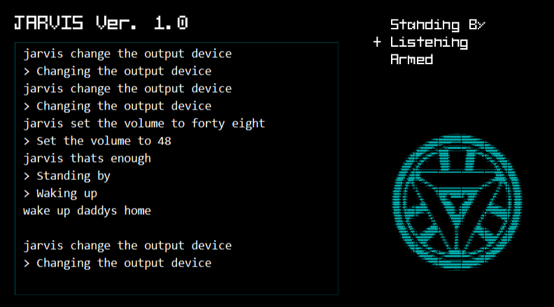

# J.A.R.V.I.S.

I wanted to control the output devices and the volume halfaway across the room, hence J.A.R.V.I.S. I plan on adding functinality beyond this, however for now its a very fancy volume button and a output changer.

## Features
- Voice commands with Vosk (offline speech recognition)
- Volume control and output device switching
- "Jarvis" command mode with automatic music ducking
- Standby mode, woken by a double clap + "wake up daddys home" (Reference to Iron Man 2)
- Console window with status display

## How it works
WORKING ON THIS SECTION

## Requirements
- Windows 10/11
- Java, JavaFX SDK
- Python 3.13 (not 3.14: PyAudio has no wheels yet)
- A microphone (a clip-on mic works best)

## Setup
1. Clone the repo
2. Download the Vosk model [(Vosk)] https://alphacephei.com/vosk/models → put it in `tools/`
3. Download NirCmd and SoundVolumeView [(Nirsoft)] https://www.nirsoft.net/  → `tools/`
4. Download the JavaFX SDK [(JavaFX)](https://openjfx.io/) → `tools/`
5. Python: create the venv, `pip install -r python/requirements.txt`
6. VS Code settings (`.vscode/settings.json`, vmArgs for JavaFX)

## Usage
WORKING ON IT

## Project structure
WORKING ON IT

## Known limitations
- Output toggling supports 2 devices
- Volume commands need the word "volume" (keyword matching)
- CommandDispatcher.java only uses if else statments which is pretty limiting architecture wise.

## Roadmap
WORKING ON IT

## Credits / third-party
Vosk, JNA, Gson, JavaFX, NirCmd / SoundVolumeView (NirSoft), clap-detector, and their licenses.